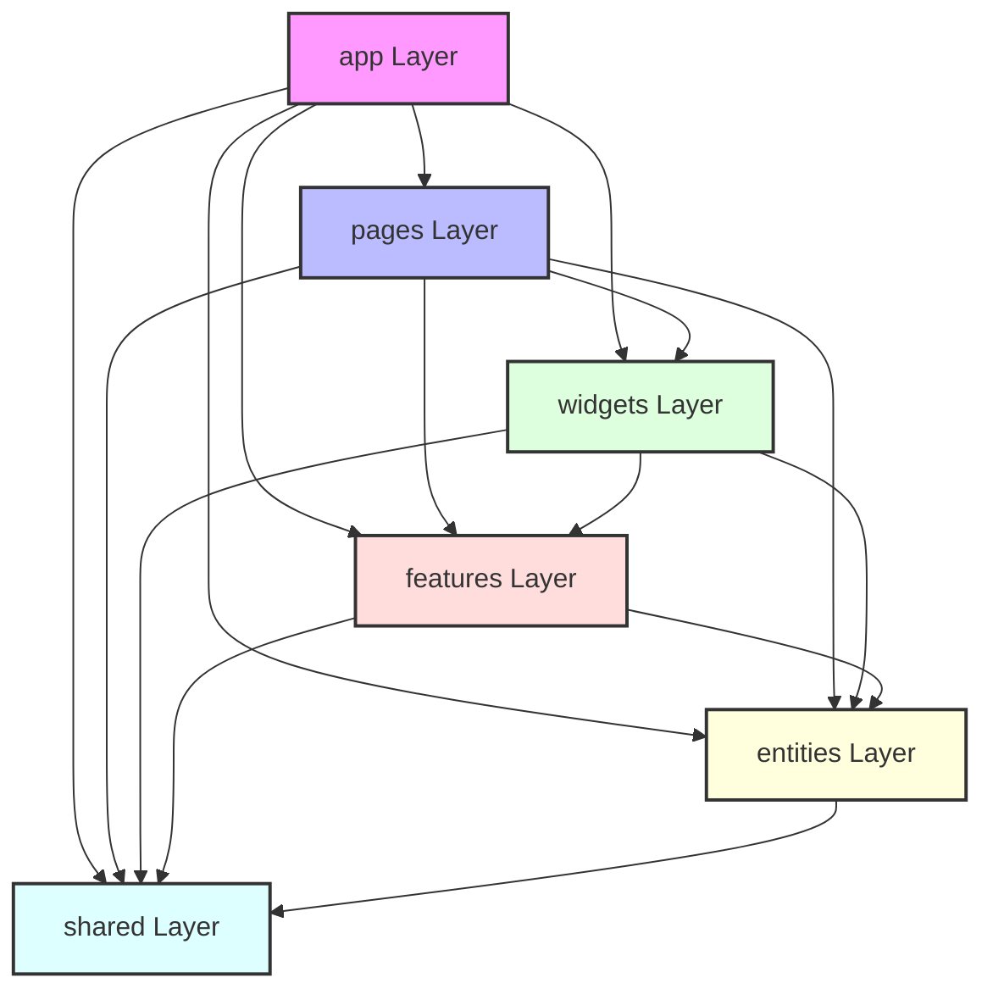

# 🎲 Vue Lottery App (FSD Refactored)

Застосунок розроблено з використанням архітектурної методології **Feature-Sliced Design (FSD)**, бібліотеки UI-компонентів **PrimeVue** та менеджеру стану **Pinia**.

---

## 🏗️ Архітектура залежностей шарів (FSD)

Потік залежностей у проєкті чітко дотримується концепції FSD (залежності спрямовані лише зверху вниз):

